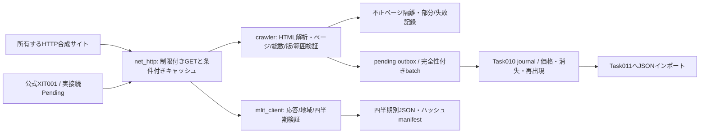

# Task 012 — HTTP収集・掲載追跡 / Network Collection & Tracking

## 日本語

後続の[XIT001実接続検証](mlit-live-verification.md)で承認済み私有設定から01／02のHTTP 200を確認。以下のPendingは初回開発時点の履歴である。

### 範囲・出典

基準コミット349fed2。Python 3.12標準ライブラリの独立HTTPクライアント、自分で管理する合成HTMLサイト、ページ解析、Task 010アダプター、公式XIT001クライアントを追加する。旧xit001.pyの未接続境界とTask 001～011のコード・モデル・研究結論は変更しない。第三者ポータルへは接続しない。新規実掲載0件、公式API実接続は**Pending（承認済みKeyなし）**。Keyの提出を要求せず、公式接続も試行していない。

2026-11-09に[公式XIT001操作説明](https://www.reinfolib.mlit.go.jp/help/apiManual/xit001)、[API全体説明](https://www.reinfolib.mlit.go.jp/help/apiManual)、[利用規約](https://www.reinfolib.mlit.go.jp/help/termsOfUse/)を確認。認証はOcp-Apim-Subscription-Keyヘッダー、東京都13・取引価格01・日本語を指定し、gzipを復号する。404は未公表または該当なしの可能性があり、取得済み・ゼロ取引にしない。固定回数の上限は確認できず、API既定2秒間隔は独自の保守設定であって公式の許可頻度ではない。承認後に条件・更新状況を再確認する。取得日時と公表日時を混同せず、manifestのpublication_dateは未知のまま。

### 構成



transportは実ソケットのHTTP/HTTPS通信で、TLSはPython既定証明書検証。接続先は固定originで、リダイレクトを追わず認証情報を転送しない。平文HTTPはloopbackのみ。HTMLアダプターは更にloopback限定。相対リンク以外を拒否する。第三者向けの許諾確認機構・サイトアダプターは未実装で、robots許可を保存・再利用許可と解釈しない。

各試行にtimeout、頻度制限、最大3試行（初回＋2回）、指数バックオフ。429/500/503・断連・timeoutを再試行、401/403/404やリダイレクトは無制限再試行しない。Retry-Afterの秒／HTTP日時を解釈し、待機予算より長ければ早く再試行せず終了し次回へ延期する。既定timeout2秒・間隔1秒・最大待機30秒。共用Client内の制限であり、別プロセス全体の配額制御ではない。robotsの禁止、Crawl-delay、Request-rateも守り、robots取得失敗は安全側に倒す。

ETag優先・Last-Modified条件GETで304時にSHA-256検証済み保存本文を使う。cacheはorigin単位、4MBの転送／復号上限。JSONキャッシュの原子置換、Task 010の単一ライター制御を利用。HTTPログはpath、status、試行、時間、バイト数だけで、認証ヘッダーやKey、応答本文を記録しない。HTTP失敗率は試行単位で、解析失敗数やバッチ完全性とは別の指標。ファイル・実行ログ・キャッシュはdata/reports内でGit無視。

### HTML完全性と中断復帰

HTMLには一覧、2件ずつのページング、独立住戸ページがあり、HTMLParserで見出し属性・リンク・住宅属性を読み取る。最大100ページ／1,000住戸。重複リンク、ページループ、欠落フィールド、不正な価格・面積、型やHTML構造変更、世代の不一致、総数不一致を検出する。開始と終了の一覧世代も照合。固定scopeが変わればcompleteを許可しない。失敗パスとエラー種類をrun reportで隔離し、元のHTMLは無視対象cacheに残す。

問題が一つでもあればpartialまたはfailed。Task 010へ完全性をそのまま渡し、欠落から消失を推測させない。全件検証時だけcomplete、完全フィードの欠落を観測確認として扱う。世代を更新し忘れた不正なサーバーや偽の全件宣言まで証明する仕組みではないため、本段階は所有サイトの契約専用である。

同じURLの本文は条件付き再利用するが、観測履歴は時刻別に残す。途中終了後はキャッシュを利用しつつページを再検証する（過去ページを無確認でskipしない）。batchを先にpending.jsonへ原子保存し、journalに取り込んでから削除する。取込み直前／直後に中断しても同じbatch IDを再実行し重複させない。プロセス強制終了でwriter.lockが残った場合は、稼働プロセスとpending/cacheを確認して人手復旧する。強制終了の自動lock回収、分散ワーカー、常駐スケジューラー、無期限耐久運転は未実装。

### 再現用の全自動デモ

追加依存なし（Streamlit画面には既存requirements.txtが必要）。rootで実行し、新しい出力先を使う：

```powershell
.venv/Scripts/python.exe -X utf8 -m japan_housing_liquidity_lab.network_demo --output data/task012-demo-new
```

HTTPサーバーを実際に起動し、5住戸初回→304再観測→価格低下→429/503から復旧→ページ2失敗（消失なし）→消失→再出現の7回を実行し終了する。site.json、journal.json、metrics.json、history内JSON/CSVをローカル保存。全てSYNTHETICであり実市場結果ではない。

Streamlitを起動し「合成デモ」→「掲載追跡」で、data/task012-demo-new/journal.jsonを選び権利確認後に取り込む。価格低下・確認不完全・最初の媒体消失・全監視媒体消失・再出現を表示できる。既存合成履歴がある場合、別接続またはセッション消去後に試す（時刻逆順を無理に統合しない）。AppTestでHTTP収集→Web取込み処理→実画面描画を検証するが、実ブラウザーのファイルダイアログ受入れ試験とは別。

手動の二つのターミナルでも動かせる：

```powershell
.venv/Scripts/python.exe -m japan_housing_liquidity_lab.mock_site --state data/task012-manual/site.json --port 8765
# 別ターミナル
.venv/Scripts/python.exe -m japan_housing_liquidity_lab.crawler --workspace data/task012-manual/crawler --journal data/task012-manual/journal.json
```

site.jsonのrowsの価格／件数を変更しgenerationを増やす。faultsはパスに対する一度ずつ消費する配列、例：`{"/listing/1":[{"status":429,"retry_after":1},{"status":503}]}`。`{"delay":3}`で遅延、`{"drop":true}`で断連。クエリ込みの`/listings?page=2`も指定可能。broken=trueで構造変更、loop=trueでページループ。公開サーバー用ではなく必ずloopbackで使用する。

### APIの増分取得（Key取得後のみ）

published.jsonは管理者が公式公表情報を確認した四半期文字列リスト、acquired.jsonは既存CSV／APIの取得・ハッシュ確認済み四半期リスト。時計や404から未公表四半期を推測しない。今ある2018Q1～2026Q2の全データを再取得する必要はない。Keyをコマンド引数やGitに置かず環境REINFOLIB_API_KEYへ管理者が設定してから：

```powershell
.venv/Scripts/python.exe -m japan_housing_liquidity_lab.mlit_client --published data/task012/published.json --acquired data/task012/acquired.json --directory data/task012/mlit
```

このコマンドは今回は実行していない。承認後の実接続、実TLS／公式配額／実レスポンスはPending。Keyなしなら通信前に終了する。四半期別JSONとmanifestで取得日・URL・件数・フィールド・SHA-256を保存し、検証済み取得単位をskipする。匿名取引の同一行は件数を報告するが消さない。地区コード等に安定した取引IDを仮定しない。APIは東京全住宅種別の元応答を保持し、中古マンションの研究取り込みは別途レビューが必要。取引価格は挂牌ではないのでTask 010へ変換しない。

同じ四半期の改訂取得、公開四半期の自動発見、複数データセットのレコード同定、APIバージョン移行、完全なAPI不正応答隔離保管は未実装。API schemaエラーは取込み拒否しmanifestを作らない。実Keyは公式HTTPS originだけへ送り、ローカルモックには固定の偽ヘッダーを送る。ユーザー指定の外部URLへKeyを転送しない。

### 実測（ローカル合成実験）

data/task012-demo-001で5住戸・3一覧ページを取得。初回10試行／本文3,960バイト、変更なし再観測10試行／本文0バイト。1回0.140～0.188秒（デモ専用10ms間隔。通常の1秒／公式2秒設定とは別）。429/503回復は12試行中2失敗（16.7%）でcomplete。ページ2継続503は7試行中3失敗（42.9%）でpartial、2件だけを観測し偽の消失0。全7回で価格低下1・消失1・再出現1を検出。これらはローカル小規模の機能実証で、インターネット性能や長期稼働SLAではない。

初回テストの失敗は、再取得が正しく304を返す場面で200のみを期待したテストを修正したもの。遅延試験でのクライアント切断もサーバーで処理した。全テストの実行：`python -X utf8 -m unittest discover -s tests -v`。公式実接続はテスト合格として計上しない。Commit/Push/配備なし。

最終検証：全143テスト成功（既存129＋新規14）、35.373秒、skipなし。公式API実接続はPendingのままであり、この件数はローカルモック試験を含む。旧303成果ハッシュは一致、既存コードの変更はREADMEリンクだけ。334ローカルファイルのGit無視を確認、ステージ済み0。

## English

The later [live XIT001 verification](mlit-live-verification.md) confirmed HTTP 200 for 01/02 using approved private configuration. Pending statements below describe the initial development run.

### Scope and architecture

Task 012 adds a standard-library HTTP transport, owned loopback HTML simulator, independent crawler, Task 010 adapter, official XIT001 client and repeatable real-socket demo. Existing research modules/models and the old disabled xit001.py boundary stay unchanged. No third-party portal is crawled and no real listing is acquired. **Live official API testing remains Pending until a key is approved**, without requesting one now.

Official sources linked above were checked on 2026-11-09. The API client sends its key in the documented header over verified HTTPS, requests Tokyo transaction data in Japanese and decodes gzip. A 404 is not proof of a published empty quarter. Acquisition dates are recorded separately from unknown publication dates. The chosen two-second API interval is a conservative local setting, not an official quota guarantee.

The transport uses actual HTTP connections, exact-origin restrictions, verified TLS, bounded timeouts, retries and backoff, Retry-After seconds/date handling, request spacing and size-limited gzip. It does not follow redirects or forward keys. HTML crawling is loopback-only until a separately permitted adapter is implemented. Robots prohibitions, delays and request rates apply but do not grant reuse rights. Client-local rate control is not a cross-process quota coordinator.

Conditional GET uses ETag/Last-Modified with origin-bound, hash-validated durable bodies. Logs omit credentials, headers and bodies; attempt failure rate is distinct from parse failures and batch completeness. Parsing checks schema, required attributes, numeric validity, duplicate links, pagination loops, total count, immutable coverage and consistent generation, including an end-of-run check. Limits are 100 pages and 1,000 details. Errors are quarantined by path/type, with original HTML retained in ignored cache. Any failure prevents complete-feed disappearance inference.

Atomic cache/outbox writes and Task 010 idempotency recover interruption around journal commits. Restart revalidates cached pages rather than blindly skipping them. New observation times produce new snapshots, not duplicate homes. A stale writer lock after process death requires inspection and manual recovery. Distributed scheduling, automatic stale-lock removal and indefinite endurance operation are not implemented.

### Reproduction and integration

Run the network_demo command above with a fresh ignored output directory. It starts a real loopback server, crawls five fictional dwellings across pages, reuses 304s, changes a price, recovers from 429/503, fails pagination safely, removes and restores a listing. It writes the Task 010 journal, history exports and measured metrics. Import journal.json through the existing Streamlit synthetic tracking page to inspect the events. A new AppTest checks collected-journal ingestion and page rendering; actual browser file-dialog acceptance remains separate.

The standalone mock_site/crawler commands allow manual scenarios. Edit site.json rows and increment generation. Path-specific fault arrays can return statuses, Retry-After, delay responses or drop connections. broken/loop flags simulate structure changes/pagination loops. The server binds loopback and is not deployment software.

### Official API preparation and limits

After approval, provide an operator-verified published-quarter inventory and integrity-checked already-acquired inventory as ignored JSON lists, set REINFOLIB_API_KEY privately, then use the documented CLI. This live command was not run. No key means failure before network access. Quarter manifests retain URL, acquisition time, fields, counts and SHA-256; validated quarters are skipped. Identical anonymous trade rows are counted but preserved. Mock origin requests always use a fake credential, never an available real key.

The API retains all Tokyo transaction types in the raw response. It is not a listing feed and is not sent to Task 010; condominium filtering/research ingestion requires separate review. Automatic release discovery, revised-quarter refresh, stable cross-dataset trade identity and full malformed-API-response quarantine are deferred. Schema failures reject acquisition without a manifest. Existing 2018–2026 acquisitions can be skipped through the supplied verified inventory. Neither the calendar nor 404 establishes release completeness.

### Measured results

The seven-run synthetic demo used five dwellings and three listing pages. Initial acquisition: ten attempts, 3,960 body bytes; unchanged acquisition: ten attempts, zero body bytes. Runs took 0.140–0.188 seconds using the explicitly faster 10ms local-demo spacing. The 429/503 scenario recovered after two failed attempts out of twelve; persistent page failure produced a partial batch after three failures out of seven attempts and no false disappearance. One price reduction, one disappearance and one reappearance were observed. These are small loopback functionality measurements, not internet throughput or a production SLA.

The first test failure incorrectly expected 200 when conditional reuse legitimately returned 304; that assertion was corrected. Delayed-server disconnects were handled. Run all unittest tests as above; do not count the pending live API test as passed. Raw data, cache, logs and credentials stay ignored. No commit, push, deployment, model training or research-conclusion changes.

Final verification: all 143 tests passed (129 existing + 14 new) in 35.373 seconds without skips. The live official API remains Pending; local mock tests do not count as live approval. All 303 prior artifact hashes match; README links are the only existing tracked-file change. All 334 checked local files are ignored and nothing is staged.
